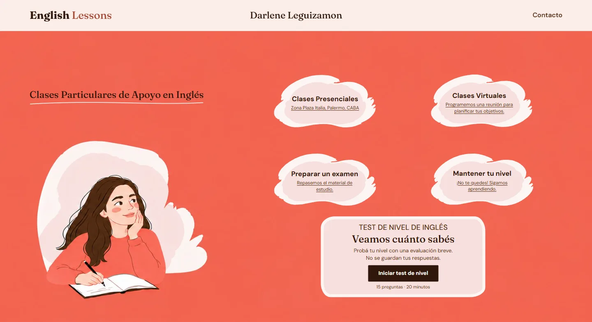
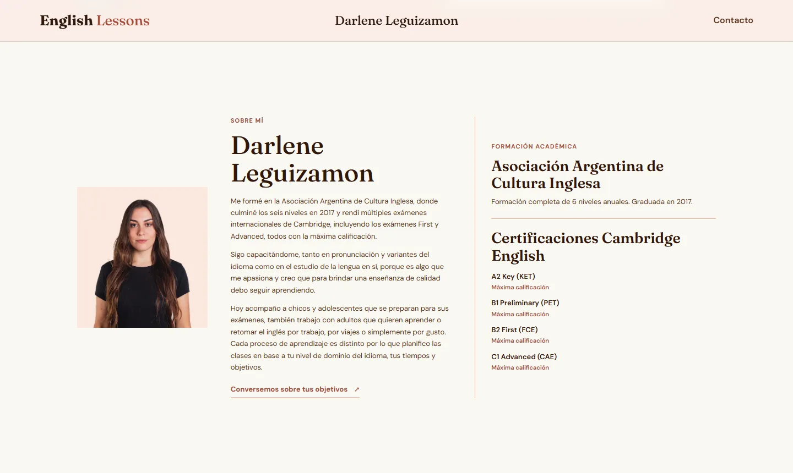
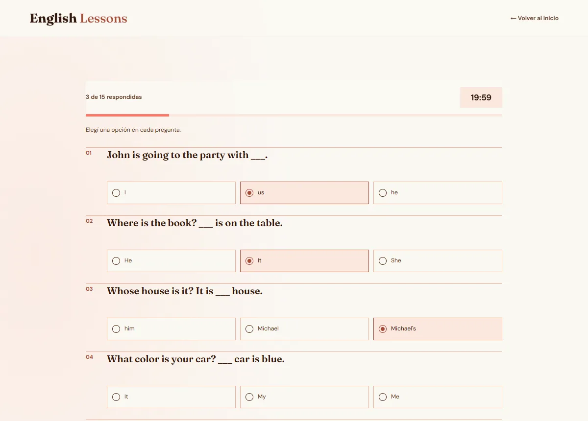

# English Lessons · Darlene Leguizamon

Sitio web para Darlene, ella es profesora particular de inglés en Buenos Aires. 

**🔗 Web activa: [englishlessons.com.ar](https://englishlessons.com.ar)**

<p align="center">
  
</p>

<p align="center">
  
  &nbsp;
  
</p>

## Qué resuelve

Quien ingresa al sitio, debe identificar simplemente qué tipo de clases da y debe tener acceso inmediato a la comunicación con Darlene vía WhatsApp. La opción de medir su nivel con un Test Online inmediato nos da una sesación de acercamiento a la docente, y un espacio de itneracción agradable.

- **Cuatro nubes, cuatro objetivos** (clases presenciales, virtuales, preparar un examen, mantener el nivel). Cada una abre WhatsApp con un mensaje según el motivo, o Google Maps con la ubicacion de referencia en el caso de las clases presenciales, digo de referencia ya que por seguridad Darlene prefirió no poner su dirección exacta.
- **Un test de nivel** de 15 preguntas y 20 minutos de tiempo limite. Al terminar, un botón de WhatsApp lleva el resultado escrito para intercambiar esa información:

> Hola Darlene! Hice el test de nivel de inglés y saqué 73% (11 de 15 correctas).


<p align="center">
  
</p>

## Funcionalidades

- **Nubes ancladas a la ilustración:** en la sección Inicio, las nubes y el recuadro del test se ubican con coordenadas de la imagen de fondo (1746 × 901 px) usando *container queries*. Siempre quedan en el mismo lugar del dibujo, con cualquier tamaño y proporción de ventana.
- **Test sin backend:** las preguntas están en un archivo aparte ([js/questions.js](js/questions.js)), así que se pueden cambiar sin tocar la lógica. Hay barra de progreso, aviso antes de cerrar la pestaña con el test empezado y confirmación si quedan preguntas sin responder.
- **Privacidad:** el test no guarda ni envía nada. El resultado se comparte solo si la persona toca el botón de WhatsApp.
- **Diseño adaptable:** tres diseños (escritorio, tablet y celular). En celular la ilustración ocupa la primera pantalla, las nubes pasan a ser fondos SVG y toda la nube se puede tocar.
- **Página 404 propia**, con enlaces al inicio y al test.

## Detalles técnicos


| **Stack** | HTML, CSS y JavaScript sin frameworks, sin dependencias y sin paso de build |
| **Peso** | ~135 KB la página de inicio y ~35 KB la del test (sin contar las tipografías). El retrato pasó de 148 KB en JPG a 31 KB en WebP |
| **SEO** | Datos estructurados `schema.org/LocalBusiness` para búsquedas locales, Open Graph para la vista previa en WhatsApp y redes, `sitemap.xml`, `robots.txt` y URL canónica |
| **Accesibilidad** | HTML validado por el W3C sin errores, foco visible con teclado, textos alternativos, `role="progressbar"` y `role="timer"` en el test, `lang="en"` en las preguntas para los lectores de pantalla y respeto de `prefers-reduced-motion` |
| **Hosting** | GitHub Pages con dominio `.com.ar` propio (NIC Argentina), DNS en Cloudflare y HTTPS |

Algunas decisiones:

- **Sin framework.** Son dos páginas con contenido fijo: React o un generador de sitios sumarían peso y mantenimiento sin aportar nada. El JavaScript completo tiene menos de 150 líneas.
- **El temporizador se calcula contra la hora de fin.** Los celulares frenan los intervalos cuando la pestaña queda en segundo plano. Si se descontara un segundo por vuelta, el reloj se atrasaría. Como se compara con la hora de fin, al volver a la pestaña el tiempo restante es el correcto.
- **WhatsApp en lugar de formulario.** Es el canal que usan los alumnos, la respuesta es más rápida y no hace falta mantener un servidor.

## Estructura

```
├── index.html          Inicio, sobre mí y contacto
├── test.html           Test de nivel (15 preguntas, 20 minutos)
├── 404.html            Página para direcciones inexistentes
├── css/styles.css      Estilos, con la paleta y las tipografías en :root
├── js/main.js          Animaciones de entrada y año del footer
├── js/test.js          Lógica del test y temporizador
├── js/questions.js     Preguntas y respuestas correctas
├── assets/img/         Ilustración, retrato (WebP), nubes SVG y favicon
├── docs/               Capturas para este README
├── CNAME               Dominio propio para GitHub Pages
├── robots.txt
└── sitemap.xml
```

## Ver en local

```bash
npx serve .
```

## Autoría

Diseño y desarrollo: **[Quantum Dev](https://www.instagram.com/developerquantum/)**, de Francis Leguizamón.

El nombre, las fotos, la ilustración y los textos pertenecen a Darlene Leguizamon y no pueden reutilizarse. El código está publicado como muestra de trabajo.
